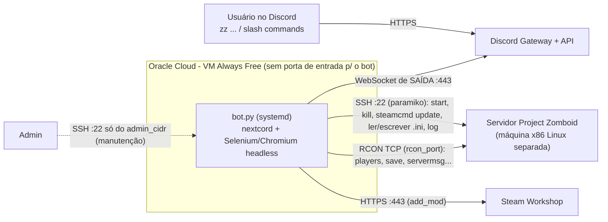

# Arquitetura: ZombiZoid na Oracle Cloud (Always Free)

## Decisão

**VM.Standard.A1.Flex (aarch64), 1 OCPU / 6 GB, Ubuntu 24.04, bot como serviço systemd nativo (sem container), provisionada por Terraform + cloud-init.** Fallback por variável: `shape = "VM.Standard.E2.1.Micro"` (x86_64, 1 GB + swap 2 GB).

Custo: US$ 0 nas duas opções, desde que dentro dos limites Always Free. O que muda é folga e risco, não preço.

## Fluxo

- O bot só abre conexões de saída. A VM não expõe nenhuma porta além do SSH de manutenção, restrito ao seu IP (`admin_cidr`, 0.0.0.0/0 é rejeitado pelo Terraform).
- **O controle do servidor é 100% via Discord.** SSH na VM serve apenas para deploy, logs e enviar o `config.yaml`.
- Pré-requisito no portal do Discord: habilitar o *Message Content Intent* (o bot usa `intents.message_content = True` para os comandos `zz`).

### Comandos reais (lidos de `client/client.py` e `client/commands.py`)

Slash commands (restritos ao `guild_id` do config):

| Comando | Função |
|---|---|
| `/status` | status do bot |
| `/running` | verifica por SSH (`pgrep`) se o servidor PZ está rodando |
| `/restart` | mata e reinicia o servidor PZ via SSH |
| `/update` | para o servidor e roda `steamcmd +runscript` no servidor |

Prefixo `zz ` (`zz help` lista tudo):

| Comando | Função |
|---|---|
| `zz log [linhas]` | últimas linhas do stdout do servidor (padrão 5) |
| `zz add_mod URL` / `zz remove_mod ID\|"Título"` / `zz list_mod` | gerencia mods no .ini (add_mod usa Selenium no Workshop) |
| `zz players`, `zz save`, `zz startrain [n]`, `zz stoprain`, `zz checkModsNeedUpdate` | RCON |
| `zz servermsg "msg"`, `zz teleport "A" "B"`, `zz additem "player" Base.Item [n]` | RCON |

## Comparação 1: shape

| Critério | A1.Flex (aarch64) | E2.1.Micro (x86_64) |
|---|---|---|
| Custo | $0 dentro da cota | $0 (até 2 VMs) |
| RAM | 1 OCPU / 6 GB (ajustável) | 1 GB fixo |
| Chromium + bot | folga ampla (~0,6-0,9 GB usados) | apertado; depende de swap 2 GB, risco de OOM/lentidão |
| Capacidade | frequentemente "Out of host capacity"; tentar outro AD/mais tarde; contas PAYG costumam ter mais sorte | geralmente disponível |
| chromedriver | sem build oficial linux-arm64 no Selenium Manager; usamos `chromium` + `chromium-driver` do PPA xtradeb/apps (existe para arm64 e amd64 no noble) | idem (mesmo PPA, mesmo procedimento) |
| Cota | doc atual: Always Free = 1.500 OCPU-h + 9.000 GB-h/mês = 2 OCPU / 12 GB no total. Contas PAYG mantêm o modelo antigo de 3.000 OCPU-h / 18.000 GB-h (4 OCPU / 24 GB), segundo relatos; 1/6 cabe em ambos | 2 instâncias de 1/8 OCPU |
| Reclamação por ociosidade | CPU p95 < 20% E rede < 20% E **memória < 20%** por 7 dias | CPU p95 < 20% E rede < 20% por 7 dias |

Nota: a premissa "4 OCPU / 24 GB" não aparece mais na página Always Free da Oracle (consultada em 2026-10-27), que fala em 2 OCPU / 12 GB. Confira em *Limits, Quotas and Usage* do seu tenancy.

Boot volume: mínimo 47 GB, total Always Free 200 GB. Usamos 50 GB.

**Ociosidade.** O bot fica ocioso quase sempre; ele vai satisfazer CPU e rede < 20%, então a VM é candidata a reclamação. Mitigações, em ordem de preferência:
1. Fazer upgrade do tenancy para Pay As You Go. Os recursos Always Free continuam sem cobrança (a doc confirma que não se cobra por Always Free após o upgrade). A isenção de reclamação para contas PAYG vem de relatos da comunidade/suporte e **não está escrita na doc**; trate como provável, não garantido. Crie um *Budget* de US$ 1 com alerta por e-mail e não crie recursos fora do Always Free.
2. Na A1, a memória também conta: com menos RAM (ex.: `memory_in_gbs = 3`) o uso do bot+Chromium passa mais perto de 20%. Não é garantia (depende de como o OCI mede memória).
3. Ter backup/IaC para recriar a VM (este Terraform): o estado do bot é só `config.yaml` e `db/mods/mods.json`. Evite "burn" artificial de CPU: é frágil e contra o espírito da política.

## Comparação 2: forma de execução

| Opção | Always Free? | Veredito |
|---|---|---|
| **systemd nativo** | sim | **Escolhida.** Zero overhead, `journalctl`, `Restart=always`, usuário sem privilégio e hardening na unit. |
| Docker/Podman na VM | sim (só a VM) | Daemon + camada de imagem (~100-200 MB RAM e disco) e Chromium em container exige `--shm-size`/sandbox extra. Ganho de reprodutibilidade pequeno para 1 serviço. Reavaliar só se houver vários serviços. |
| OCI Container Instances | **não** | Não consta na lista Always Free da Oracle (a página não lista); é cobrado por OCPU/GB-hora. |
| OKE | **não** (nós/overhead) | Não consta como Always Free. Mesmo com nós A1, o overhead de Kubernetes é desproporcional para 1 bot. |

## Servidor do Zomboid

Não roda nesta VM. Em A1 o steamcmd e o servidor são x86, exigindo emulação (box64/FEX), frágil. Em E2.1.Micro não cabe em RAM. Mantenha-o em máquina x86 separada, alcançável por SSH e RCON a partir do IP público da VM Oracle.

## Fragilidades conhecidas

- `client/navigator.py` abre o Chrome no import: sem Chromium+chromedriver funcionando o bot nem inicia (o Selenium é obrigatório, não opcional).
- Autenticação SSH só por senha no código upstream (`patches/` tem patch ilustrativo para chave).
- PPA xtradeb é de terceiros: fixa a origem de Chromium; atualizações de major podem exigir reinício do serviço.
